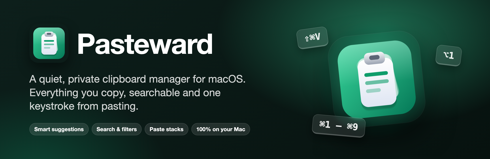
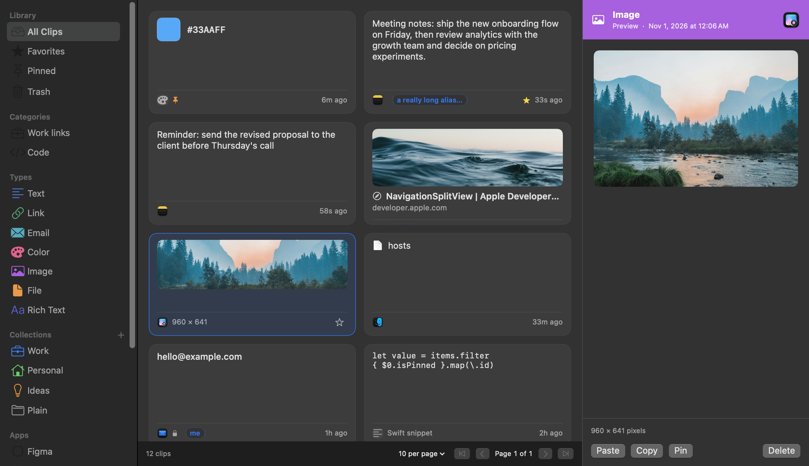
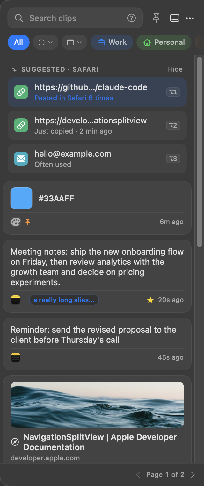
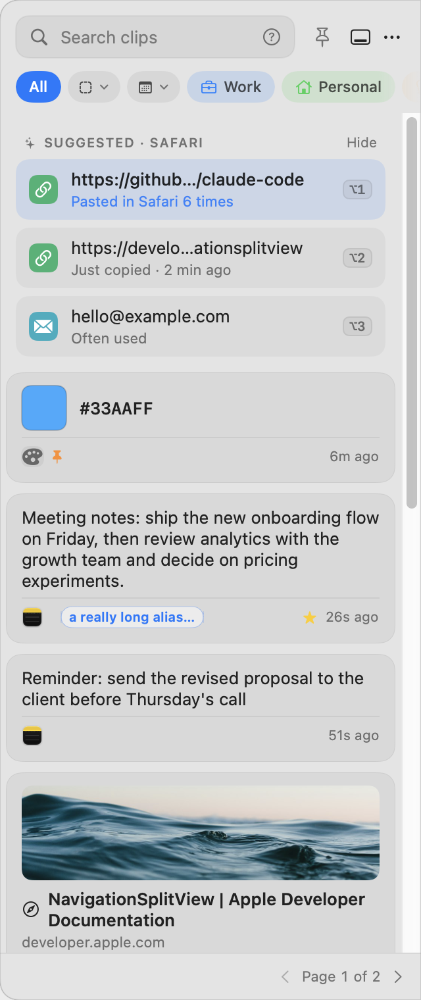
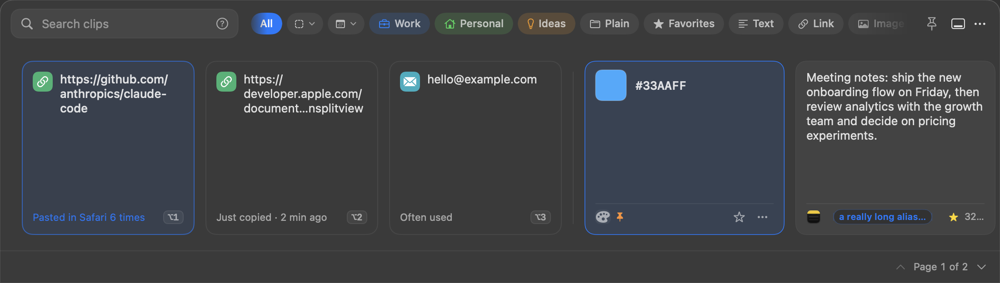
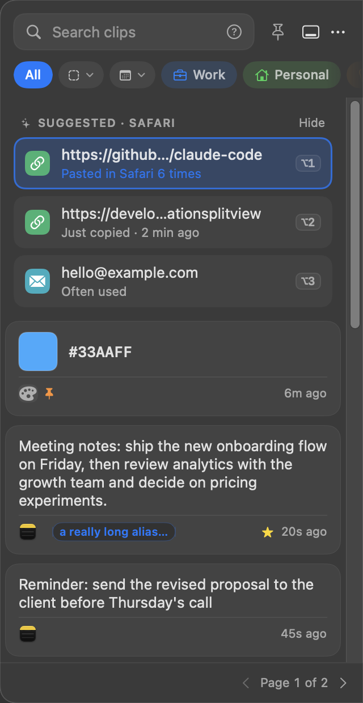
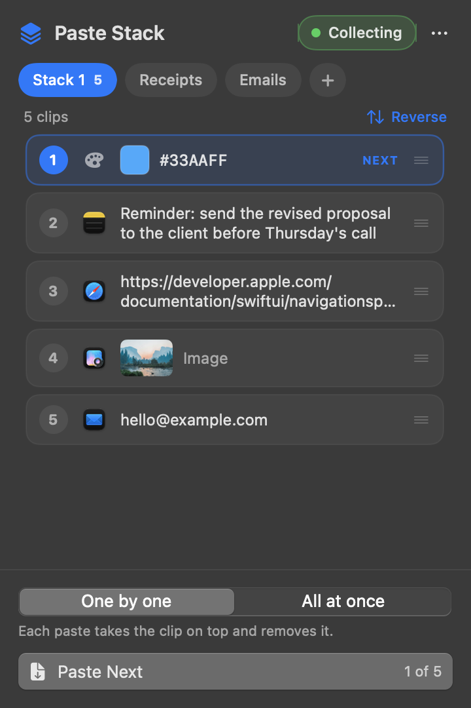

  

  
   
  One-time license · 14-day refund · macOS 14 or later · Apple silicon

  
  

  

## Why Pasteward

macOS remembers one thing at a time. Pasteward remembers all of it, keeps it on your Mac, and gets it back to you faster than you can find it again.

- ✅ **Native and fast.** A small menu bar app written in Swift. Opening a page of clips takes a fraction of a millisecond with 20,000 clips in history; idle, it uses about 0.1% CPU.
- ✅ **Private by construction.** No account, no cloud, no analytics, no tracking. Your history lives in a local database that only you can read.
- ✅ **You choose what is left out.** Password manager apps are ignored by default, and switches skip passwords, API keys, private keys, tokens and card numbers. Ignore any app, folder or word too.
- ✅ **A Quick Panel that stays out of your way.** It slides in without taking the keyboard from the app you are typing in.
- ✅ **Suggestions that explain themselves.** The clips you are most likely to paste next appear on top, each with a plain reason.
- ✅ **Search that understands you.** Instant, forgiving, with operators like `app:Safari type:link after:2026-10-01`.
- ✅ **Paste the way you want.** Plain text, 50 built-in text transforms, bulk paste and paste stacks.
- ✅ **Automatic backups** of your history, with one-click restore.
- ✅ **Pay once.** A lifetime license, no subscription.

## Quick Panel

Press **⇧⌘V** from any app. The panel opens beside what you are doing without stealing focus: pick a clip with the arrow keys, press **↩**, and it pastes. Dock it to any screen edge, float it, or open it at your pointer or text cursor.

  
  &nbsp;&nbsp;
  

- Chips under the search bar filter by collection, favorites, type, app or date, and by categories you define.
- Drag a clip into another app, hover for a full preview, or press **⌥1 – ⌥5** to paste one of the suggestions straight away.
- Prefer a strip? Dock it to the bottom or top of the screen.

  

## Suggestions

The clips you are most likely to paste next sit above your history, each with a reason you can read: *Pasted in Safari 6 times*, *Just copied*, *Often used*. Pasteward learns where you paste on your Mac only, and never reads or stores what you copied to do it.

  

Suggestions are part of the paid plans.

## Paste Stack

Copy a series of things, then paste them one after another, or all at once. With the stack collecting, **⌘V** in any app pastes the next clip. Keep several stacks, reorder them by dragging, and join clips with a new line, a space, a comma or your own separator.

  

## Organize without effort

- **Collections** with their own colors and icons.
- **Favorites, pins and aliases**: give a clip a short name and type it to find it.
- **Categories**: rules that sort clips for you, including "looks like code".
- **Search operators**: `app:`, `type:`, `col:`, `alias:`, `after:`, `before:`, `fav:true`, `pinned:true`, `-word` and `"exact phrase"`.

## Install

**Requirements:** a Mac with Apple silicon (M1 or later) running macOS 14 (Sonoma) or later.

1. Buy a license at [pasteward.com](https://pasteward.com), then paste your key on [pasteward.com/download](https://pasteward.com/download) to download `Pasteward-<version>.dmg`.
2. Open it and drag **Pasteward** to **Applications**.
3. Open Pasteward. It lives in your menu bar.
4. macOS may say it can't verify the app, because releases are not yet notarized by Apple. You confirm once:
   - **macOS 15 (Sequoia) or later:** double-click Pasteward and click **Done**. Then open **System Settings → Privacy & Security**, scroll to **Security**, click **Open Anyway** next to "Pasteward was blocked", and confirm with your password or Touch ID.
   - **macOS 14 (Sonoma):** right-click Pasteward in Applications, choose **Open**, then **Open** again.
   - **Any version, from Terminal:** `xattr -dr com.apple.quarantine /Applications/Pasteward.app`
5. When asked, allow Pasteward under **System Settings → Privacy & Security → Accessibility**. That is what lets it paste for you. Without it, clips are still copied and you press ⌘V yourself.

### Updates

Choose **Settings → General → Software update → Check for Updates…**, or switch on automatic checks there. Updates are signed, and Pasteward verifies the signature before installing anything.

## Plans

Pasteward needs a lifetime license: one payment, no subscription, valid for as many devices as your plan includes. If it is not for you, ask for a refund within 14 days.

| Plan | Devices | Support | Price |
|---|---|---|---|
| **Standard** | 2 | Standard | $14.99 |
| **Pro** | 5 | Priority | $24.99 |
| **Family** | 15 | Priority | $39.99 |

**Buy:** [**Polar** (choose a plan)](https://buy.polar.sh/polar_cl_0Xz9c53Kl8Bs878gLGWruF0nCSLtynFgMloli3Ivrk9) · [**Lemon Squeezy** (choose a plan)](https://jaiedsabid.lemonsqueezy.com)

After you buy, open **Settings → License**, choose the site you bought from, paste your key and click **Activate**. To move a license to another Mac, click **Deactivate This Mac** first.

## Privacy

- Your history is stored in `~/Library/Application Support/Pasteward`, readable only by you. It is never uploaded.
- No analytics, no crash reporting, no account, no ads.
- The only network use is optional and visible: link previews for links you copied (you can turn them off), the update check (once a day by default; switch it off in Settings → General), and checking your license key with the site you bought it from (Polar or Lemon Squeezy), about once a week after you activate.
- Password manager apps are ignored by default. You can switch on skipping of concealed items, API keys, private keys, tokens and card numbers, and ignore whole apps, folders and words.

## Support

- **Something wrong?** [Open an issue](https://github.com/jaiedsabid/pasteward-releases/issues/new/choose). In Pasteward, **Settings → Support** opens the form with your version and macOS filled in and can copy the diagnostic info for you.
- **Idea?** Open an issue too. Requests are read, answered, and shipped as soon as they are ready.
- **License problems, refunds and anything private:** email contact@devscrate.com with the address you bought with and the site you bought from (Polar or Lemon Squeezy). Please don't post your key in an issue.
- **Security or privacy problem?** Email instead of opening a public issue. See [SECURITY.md](SECURITY.md).

This repository holds the screenshots and the public tracker for issues and feature requests reported by users. The app is sold at [pasteward.com](https://pasteward.com) and the source code is not published, so pull requests are not accepted.

---

© 2026 Pasteward. All rights reserved.

